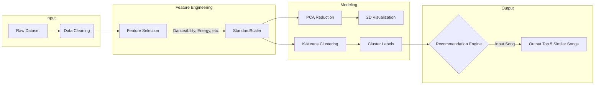

  
  <h1>Spotify Genre Segmentation & Recommendation</h1>
  
  

    An Unsupervised Machine Learning project that clusters songs based on audio features and builds a recommendation engine.
  

  
  

  
  
  

<h4>
    <a href="#-system-architecture">View Architecture</a>
   · 
    <a href="#-installation">Installation</a>
   · 
    <a href="#-results">View Results</a>
</h4>

 

# 📖 Table of Contents

- [📍 Overview](#-overview)
- [🧠 Methodology](#-methodology)
- [📐 System Architecture](#-system-architecture)
- [📂 Project Structure](#-project-structure)
- [🚀 Installation & Usage](#-installation--usage)
- [📊 Visualizations](#-visualizations)

---

# 📍 Overview

This project analyzes a dataset of Spotify tracks to identify distinct clusters of songs based on their audio characteristics (e.g., danceability, energy, acousticness). 

By applying **Principal Component Analysis (PCA)** for dimensionality reduction and **K-Means Clustering**, we segment songs into groups. These clusters are then used to power a **Content-Based Recommendation System** that suggests songs mathematically similar to a user's input.

### Key Features
| 🔍 Exploratory Analysis | 🤖 Machine Learning | 🎵 Recommendation |
| :--- | :--- | :--- |
| **Correlation Heatmaps:**  Identify relationships between audio features. | **PCA:**  Reduces high-dimensional data for visualization. | **Cluster Matching:**  Finds songs within the same geometric cluster. |
| **Distribution Plots:**  Analyze the spread of genres and audio attributes. | **K-Means:**  Segments songs into 5 distinct genre/style clusters. | **Similarity Check:**  Filters recommendations based on feature proximity. |

---

# 🧠 Methodology

The project follows a standard Data Science pipeline:

1.  **Data Preprocessing:** * Removal of duplicates and missing values.
    * Dropping non-numeric identifiers (`track_id`, `track_uri`, etc.).
2.  **Feature Standardization:** * Uses `StandardScaler` to normalize features (Mean=0, Std=1) so that high-magnitude features (like Loudness) don't dominate the distance calculations.
3.  **Dimensionality Reduction:**
    * **PCA (Principal Component Analysis)** is applied to compress the 9 audio features into 2 primary components for visualization purposes.
4.  **Clustering:**
    * **K-Means Algorithm** groups the data into 5 clusters (`k=5`).
    * $$\text{Minimize } \sum_{i=1}^{k} \sum_{x \in S_i} || x - \mu_i ||^2$$

---

# 📐 System Architecture

Project Structure
Plaintext

├── spotify_analysis.ipynb      # Main Jupyter Notebook (or .py script) containing all logic

├── spotify dataset.csv         # Source data (ensure this is in root)

├── requirements.txt            # Python dependencies

└── README.md                   # Project documentation

Installation & Usage
1. Clone the Repository
Bash
git clone [https://github.com/your-username/spotify-genre-segmentation.git]([https://github.com/your-username/spotify-genre-segmentation.git](https://github.com/Soham-o/Spotify_Songs_Genre_Segmentation.git))
cd spotify-genre-segmentation
2. Install Dependencies
Bash
pip install -r requirements.txt
3. Run the Analysis
If using the Python script:

Bash
python spotify_analysis.py
4. Get Recommendations
To use the recommendation function inside the script/notebook:

Python
# Example Usage
rec = recommend_songs('Shape of You', df_final)
print(rec)
📊 Visualizations
The script generates several key insights:

Feature Distributions: Histograms showing the spread of Audio Features.

Correlation Matrix: A heatmap displaying how features like Energy and Loudness are positively correlated, while Acousticness and Energy are negatively correlated.

PCA Cluster Plot: A scatter plot visualizing how the K-Means algorithm has grouped the songs in 2D space.

Built with ❤️ using Python, Scikit-Learn, and Pandas

